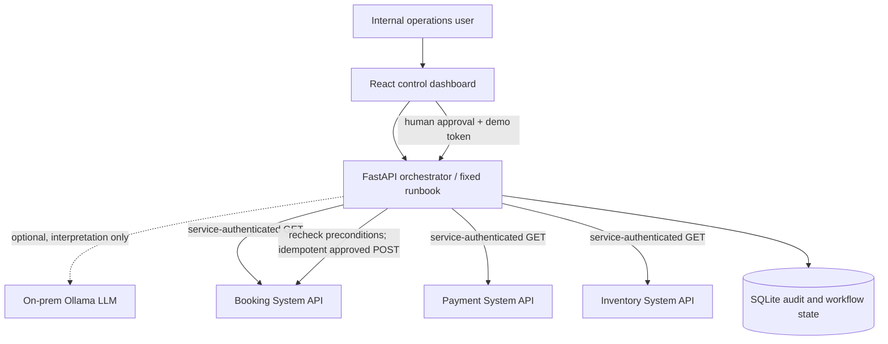

# Systems - AI Orchestration for Business Systems

**Engineering proof of concept.** The three business systems are synthetic, isolated, local API simulators.

The project demonstrates an **AI-assisted control plane for on-premises business applications that coordinate other systems**. A user describes a reconciliation problem; the orchestrator reads booking, payment and inventory services, evaluates an explicit policy, and requires a separate operator to approve one safely constrained write.

## What is actually implemented

- **Three separate HTTP microservices**: Booking, Payment and Inventory, each running independently in Docker Compose.
- **FastAPI orchestration service**: one allowlisted reconciliation runbook, concurrent authenticated HTTP calls to the three systems, failure handling and short timeouts.
- **Optional local LLM**: Ollama interprets a natural-language request using a JSON Schema, and creates a separate **advisory operator briefing** from selected system-owned status fields. The LLM can *select the one permitted runbook* but cannot generate or execute tools, SQL or arbitrary API requests.
- **Deterministic default mode**: a rule-based extractor makes the demo run without an LLM. This mode is explicitly labelled in the UI; it is **not** a working LLM demo until Ollama is enabled.
- **Policy-gated actions**: only payment CAPTURED + inventory hold ACTIVE + booking PENDING_PROVIDER with sync FAILED can be proposed for manual approval.
- **Approval and revalidation**: different named requester/approver, a demo approval token, fresh reads from every system immediately before a write, and no automatic retries for uncertain results.
- **Idempotent action**: booking service implements an idempotency-key ledger with SQLite transactions.
- **Persistent investigation/audit state**: local SQLite for investigations, timestamps, actors and structured events. This is a demo audit record, **not** a cryptographically immutable audit trail.
- **Operator dashboard**: React interface with scenario selection, outcomes, approvals, system state and event timeline.

## Quick start (Windows PowerShell)

Requirements: Docker Desktop with Docker Compose. No AWS account, GPU or cloud service needed for deterministic mode.

```powershell
Copy-Item .env.example .env
# Edit .env if you want different local-only demo secrets.
docker compose up -d --build
```

Open **http://localhost:5174**. API documentation at **http://localhost:8100/docs**.

Try **BK-2047** for an approved recovery path. Try **BK-2048** (declined payment), **BK-2049** (already confirmed), and **BK-2050** (expired inventory hold) to demonstrate protective blocking.

For the BK-2047 approval step, enter a different approver name from the requester, and copy the `APPROVAL_TOKEN` from your own `.env` file (example `local-demo-approval-token`). All effects are against **synthetic booking data only**.

### Test directly via PowerShell

```powershell
$investigation = Invoke-RestMethod `
  -Uri 'http://localhost:8100/api/investigations' `
  -Method Post -ContentType 'application/json' `
  -Body '{"query":"Investigate booking BK-2047 and reconcile its failed provider confirmation","requested_by":"analyst"}'
$investigation | ConvertTo-Json -Depth 12

$approvalToken = 'local-demo-approval-token'  # From .env; local demo only
Invoke-RestMethod `
  -Uri "http://localhost:8100/api/investigations/$($investigation.id)/approve" `
  -Method Post -ContentType 'application/json' `
  -Headers @{'X-Approval-Token'=$approvalToken} `
  -Body '{"approved_by":"team.lead"}' | ConvertTo-Json -Depth 12
```

## Enable an actual local LLM with Ollama

The Ollama server is optional and runs locally on a Docker network. **GPU is not required**, although inference performance can be poor without acceleration. Make sure your machine has enough RAM for the model.

```powershell
# Stop the deterministic container stack, if running, without deleting data.
docker compose down
# Edit .env: PLANNER_MODE=ollama
docker compose --profile ai up -d --build
# Download a model into the LOCAL Ollama container (requires internet once).
docker compose exec ollama ollama pull qwen2.5:3b
# Ollama mode is now used for structured intent extraction.
```

The model first receives the user's investigation request and returns `{ "workflow": "reconcile_booking", "booking_id": "BK-2047" }` (schema enforced and revalidated). After the services have been queried, a second model call receives a **minimal, synthetic, non-personal operational snapshot** (booking status, payment status, inventory hold, and the simulated provider note) to prepare an **advisory-only** briefing. Business decisions and writes remain deterministic and policy-controlled. In a real environment, sensitive fields require redaction and explicit data access controls before model exposure.

If Ollama is unreachable or the model returns an invalid response, the investigation request fails explicitly. The service **does not silently misrepresent deterministic mode as LLM mode**.

To revert, set `PLANNER_MODE=mock` and run `docker compose up -d --build`.

## Architecture



More detail: [Architecture](docs/ARCHITECTURE.md) and [Technical-lead demo script](docs/DEMO_SCRIPT.md).

## Source layout

```text
backend/app/             FastAPI orchestration API, planner, gateway, runbook, SQLite audit
backend/mock_systems/    Independent synthetic booking/payment/inventory APIs
backend/tests/           Policy and approval tests
frontend/src/            React control dashboard
compose.yaml             Five services + optional Ollama profile
.env.example             Demo-only configuration
```

## Verification

The unit/integration-level workflow tests use fake service adapters to verify no write occurs without approval, maker-checker rules, blocked states, and revalidation. Live Ollama and Docker/frontend builds were not executed in the authoring environment:

```powershell
cd backend
python -m pip install -r requirements.txt pytest
python -m pytest tests -q
```

Use the [demo script](docs/DEMO_SCRIPT.md) to verify real HTTP calls across all three containerised services. Docker Compose integration has to be verified on a machine where Docker is available.

## Reset test data

The booking service persists its simulated state. After a successful BK-2047 retry it becomes CONFIRMED; further investigations should block appropriately. To start over, run the following **only if you intend to delete this POC's local Docker volumes, all synthetic booking state and audit history**:

```powershell
docker compose --profile ai down -v
```

## Limits and security gaps

This is **not production-ready**. Approval identity is a self-declared string plus a demo token; there is no SSO/RBAC, cryptographically verifiable actor identity, segregation-of-duties policy engine, certificate-based service identity, immutable audit storage or confidential customer data. A real platform requires mTLS/OIDC, per-tool authorisation, replay protection, token rotation, network isolation, encrypted storage, redaction and approval integration. SQLite is a demo workflow database, not a multi-node distributed transaction manager. There is no actual booking provider, payments integration, reservation concurrency, payment capture/reversal, or production RAG. Treat the names and endpoints as examples.

**Architectural proposition:** use models to interpret and assist; use existing trusted services and bounded runbooks to perform business operations.
