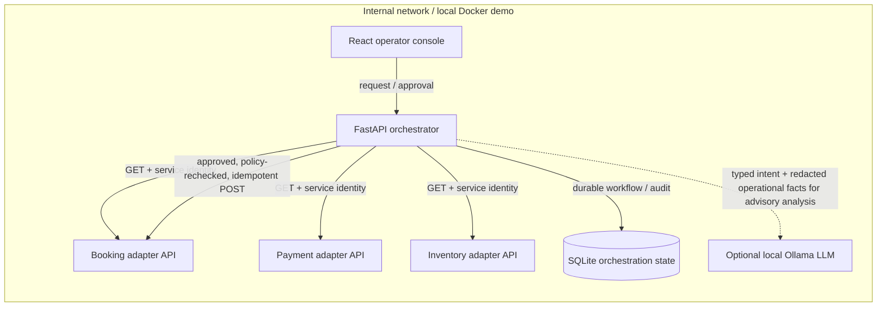
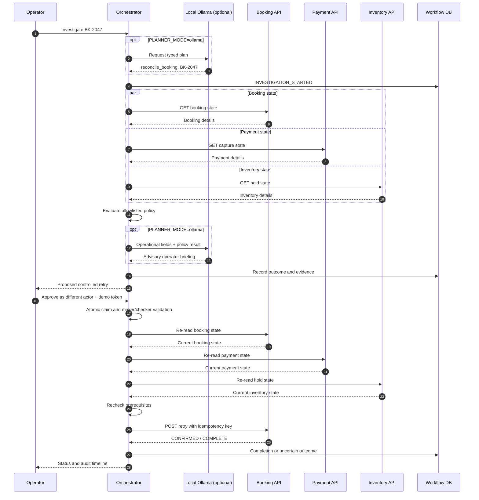

# Architecture and design decisions

**Scope:** AI-assisted orchestration for **internal on-premises business systems**.

## Use case

A captured payment and a failed provider-confirmation sync leave the booking in an unresolved state. An internal operator asks the orchestration layer to investigate booking `BK-2047`. The orchestrator reads three separate systems, checks an explicit business policy, and creates a proposed action. A different actor must approve it. The service then re-reads all three systems, confirms the policy still holds, and sends one idempotent retry command to the booking system.

## Component and trust boundaries

**Not an autonomous executor.** The model is only allowed to return a strictly validated `reconcile_booking` plan and a booking ID explicitly named by the operator. It cannot invoke arbitrary URLs, execute SQL, select mutation tools or change authorisation rules. The fixed runbook owns all system calls. This deliberate scope keeps the POC demonstrable and provides a safe baseline for discussing future agent/tool-calling capabilities.

## Workflow

## System contracts

| System | API | Data returned / effect |
|---|---|---|
| Booking | `GET /bookings/{id}` | `status`, `sync_status`, failure note |
| Payment | `GET /payments/by-booking/{id}` | capture status, synthetic amount, reference |
| Inventory | `GET /holds/by-booking/{id}` | hold status |
| Booking | `POST /bookings/{id}/retry-confirmation` | An **idempotent** mock provider-confirmation transition |

The real system boundary would be adapters over existing internal APIs, SOAP/legacy systems, a messaging broker or a workflow engine depending on actual capabilities. The POC does not need RabbitMQ merely to demonstrate three API integrations. For long-running or asynchronous real-world operations, add a durable workflow engine and event/callback model rather than waiting synchronously for arbitrary external effects.

## Runbook policy and cases

| Booking | Booking sync | Payment | Inventory | Expected outcome |
|---|---|---|---|---|
| BK-2047 | Failed | Captured | Active | Await separate approval, then retry |
| BK-2048 | Failed | Declined | Active | Block, no write |
| BK-2049 | Complete | Captured | Consumed | Already confirmed, no write |
| BK-2050 | Failed | Captured | Expired | Block, no write |

All conditions are evaluated in Python **after** fetching server-owned data. The LLM cannot assert that the payment is captured or the hold is active.

## Governance and failure handling

1. **Read isolation:** system requests use a service-to-service token and correlation ID. A future platform should replace shared secrets with workload identity, mTLS and fine-grained service permissions.
2. **Model boundary:** Ollama receives the operator request for structured intent extraction, then selected non-personal status fields for advisory commentary. Structured responses are validated using Pydantic, and booking ID must appear verbatim in the user's request. Neither model output is trusted as business evidence or authority.
3. **Hard preconditions:** status checks are deterministic and deliberately conservative.
4. **Maker/checker:** the approver must differ from the requester. The DB atomically claims one approval to prevent concurrent executions for the same investigation. Real identity is not verified in this POC.
5. **TOCTOU protection:** before write, the orchestrator re-reads all systems. This still does not guarantee cross-system atomicity; production requires an authoritative provider/booking command enforcing all relevant constraints.
6. **Idempotency:** a retry uses the investigation ID as an idempotency key. The booking simulator stores key and response in one SQLite transaction with the booking state change.
7. **Uncertain outcomes:** timeouts or failed verification result in `EXECUTION_UNCERTAIN`, not an unbounded retry. Operators reconcile state before taking further action.
8. **Audit:** a separate append-event table tracks state and actor claims. Its contents are mutable by privileged database access and are **not** immutable evidence.
9. **Synthetic scope:** there is no booking fulfilment, inventory reservation guarantee or real payment movement.

## On-premises evolution

- Keep existing applications and operational databases on-premises.
- Deploy adapters close to system-of-record APIs, with controlled network paths and service identity.
- Consider local inference (e.g. Ollama) where policy, data residency, network access or latency favour it. Benchmark model accuracy, token throughput and hardware requirements before committing.
- Add a central policy decision point and durable process/workflow state if moving beyond one runbook.
- Use RAG only if agents need unstructured API docs, runbooks or support knowledge. **RAG is not the source of truth for booking/payment/inventory transaction state.**
- Add async queues where workflows become long-running and require retries, callbacks or integration with systems lacking synchronous APIs.
- Instrument every workflow step with request IDs, traces, structured logs, policy decisions, latency and tool error rates.
- Require approvals for writes, refunds, inventory changes and other material operations. Prefer constrained, domain-specific tools to unconstrained shell or SQL access.

## Future phases (not implemented)

1. Real enterprise SSO and strong approver identities.
2. Durable workflow orchestration (e.g. Temporal or platform-supported equivalent), callback-driven partner operations and compensation design.
3. Policy-driven, registry-based agent tool selection, isolated sandbox, structured model responses and adversarial testing.
4. Service-to-service observability, load/failure injection, tracing and operational SLOs.
5. Real platform discovery before choosing Nomad, Kafka/RabbitMQ, PostgreSQL or external AI infrastructure.

The core interview claim is not that AI should replace existing integration orchestration. It is that **language models can help classify and plan, while existing integration contracts, runbooks and business policy enforce reality and execution safety**.
